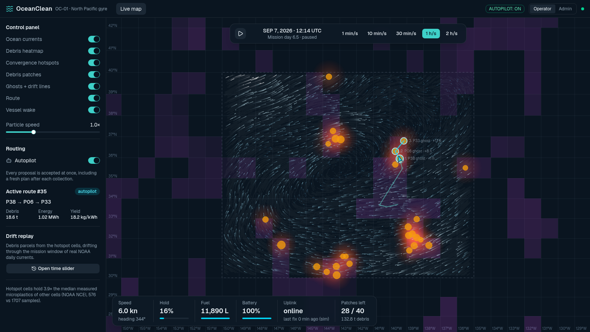
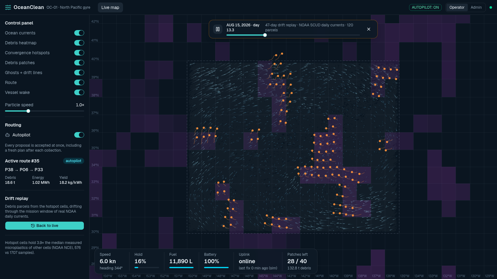
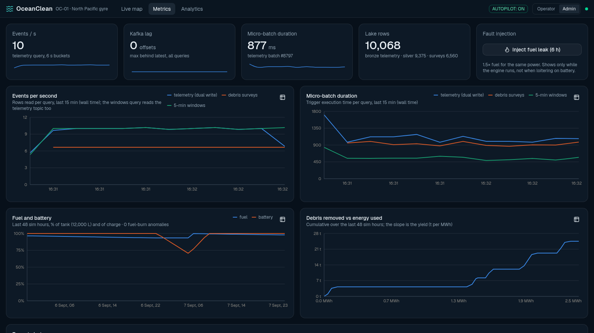
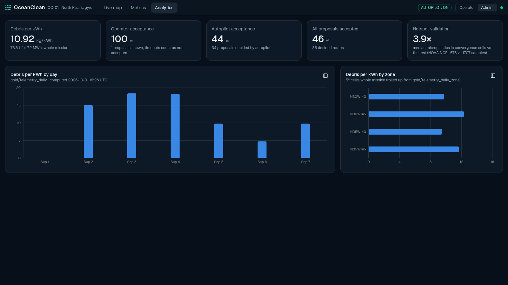
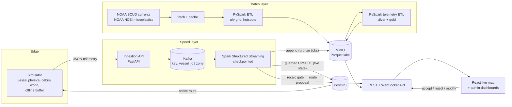

# OceanClean

A big-data prototype that plans cleanup routes for one ocean-plastic cleaning vessel. It predicts where debris patches will drift on real NOAA surface currents and sends the vessel to meet them there, so each unit of energy collects as much debris as possible.

Synthetic vessel telemetry and public ocean data flow through a Lambda architecture (Kafka, Spark Structured Streaming, PySpark batch, PostGIS, a Parquet lake on MinIO) to a live map, where an operator or the autopilot accepts the proposed routes. Everything runs locally with Docker Compose, on open-source software only.



## What it shows

1. **There is a garbage patch.** A Spark job over two years of NOAA SCUD daily surface currents finds persistent convergence cells in the North Pacific gyre. Measured microplastics (NOAA NCEI) are **3.9× higher** (median) in those cells than elsewhere (576 vs 1,707 samples).
2. **It drifts.** A time slider replays debris parcels from the hotspot cells drifting through 47 days of real currents.
3. **Predictive dispatch.** The optimizer predicts where each patch will be, plans an intercept route through up to three of them, and proposes it. The operator can **Accept**, **Reject** or **Modify** it (drag a waypoint). If nobody answers within 30 s, the vessel keeps its route or loiters. Autopilot, the default, accepts every proposal.
4. **Cleaned in about a month.** On a compressed simulation clock, the vessel works through the patch cluster while the dashboards track debris removed against energy used.
5. **It is big data.** A backfill sends the previous 30-day mission, logged at 1 Hz (**2.59 M events**), through ingestion, Kafka and Spark in about 3.5 minutes. The Metrics tab shows throughput, Kafka lag and micro-batch times, and the Analytics tab reads the lake's gold aggregates.

| Drift replay (time slider) | Metrics (admin) | Analytics (admin) |
|---|---|---|
|  |  |  |

## Architecture



- **Speed layer.** Spark Structured Streaming reads the `telemetry` topic. In each micro-batch it does a **dual write**: an UPSERT of the vessel's live state into PostGIS, guarded so an older event never overwrites a newer one, and an append of every tick to the bronze Parquet lake. Late and offline-buffered events reach both sinks ([ADR-0005](docs/adr/0005-late-events-reach-every-sink.md)). A separate query with a watermark computes 5-minute event-time windows, scores energy use and raises fuel-burn anomaly alerts.
- **Batch layer.** PySpark turns NOAA NetCDF currents into a gridded `u`/`v` field (silver, partitioned by date), monthly climatology, convergence hotspots and the hotspot–microplastics validation (gold). A second job deduplicates telemetry into silver and aggregates daily and per-zone gold tables for the Analytics tab.
- **Routing.** A pure-Python optimizer advects patches on the current field (RK2), solves the moving-target intercept by bisection, scores targets by debris mass per unit energy, and chains up to three of them. A **recalc gate** replans only when a predicted intercept point moves more than 2 km, a target is collected, or there is no route.
- **Human in the loop.** New routes start as `pending`. The operator decides in the modal while the sim clock is held. On timeout the vessel keeps its current route or loiters on battery (SRS §5.4).

## Tech stack

| Concern | Choice |
|---|---|
| Messaging | Apache Kafka 3.7 (KRaft), 6 partitions keyed by `vessel_id\|zone` |
| Stream and batch processing | Apache Spark / PySpark 3.5.1 (Java 17) |
| Operational store | PostgreSQL + PostGIS (SRID 4326) |
| Data lake | MinIO (S3 API), Parquet, bronze/silver/gold layout |
| Services | Python 3, FastAPI, confluent-kafka, psycopg |
| Frontend | React, TypeScript (strict), Tailwind, shadcn/ui, Leaflet with canvas particle layers, Recharts |
| Deployment | Docker Compose, fully local, no cloud account |

## Running it

### Requirements

- Docker with Compose v2, and about 10 GB of free disk.
- A desktop or landscape-tablet browser at 1080p or more (no mobile layout).
- Internet for the first data fetch only. After that, everything works offline from `data/cache`.

### Start and stop

```bash
./start.sh   # build images, prepare the ocean data if needed, start everything, wait for the API
./stop.sh    # stop and remove every container; data volumes are kept
```

On the first run, `start.sh` also fetches the NOAA data and runs the Spark batch ETL before starting the stack. The fetch downloads about 25 months of SCUD currents and takes roughly 25 minutes. Later starts skip this step, and `stop.sh` then `start.sh` resumes the same simulation. Without network the fetch falls back to `data/cache`.

The same steps by hand, if you prefer:

```bash
mkdir -p data/cache   # create it first, or Docker creates it root-owned
docker compose -f infra/docker-compose.yml --profile batch run --rm --build -u "$(id -u):$(id -g)" fetch
docker compose -f infra/docker-compose.yml --profile batch run --rm spark-batch
docker compose -f infra/docker-compose.yml up -d --build
```

Open **http://localhost:8080**. Press play in the clock bar, or set the clock rate and pause state through the API:

```bash
curl -s -XPOST localhost:8002/sim/clock -H 'content-type: application/json' -d '{"paused": false, "rate": 3600}'
```

Settings and their defaults live in [.env.example](.env.example). To override a value, create a `.env` next to it; never commit it.

### Demo walkthrough

| Step | How |
|---|---|
| Watch the vessel intercept drifting patches | Live map, clock at 1 h/s |
| Decide routes yourself | Turn **Autopilot** off in the side panel; the next proposal opens the AI Route Optimization modal |
| Replay real drift | **Open time slider** in the side panel |
| Inject a fault | Admin → Metrics → **Inject fuel leak (6 h)**; a fuel-burn anomaly alert follows |
| Big-data burst (2.59 M events) | `docker compose -f infra/docker-compose.yml --profile batch run --rm --build backfill` (needs the live run at least one sim-hour past the start), then watch Metrics |
| Refresh analytics now | `docker compose -f infra/docker-compose.yml --profile batch run --rm telemetry-etl` (it also reruns every 3 minutes) |
| Clean restart | `infra/reset_sim.sh` (keeps currents and hotspots) |

Switch between the **Operator** and **Admin** roles in the header. The Metrics and Analytics tabs are admin-only.

### Services and ports

| Service | Port | Notes |
|---|---|---|
| web (nginx) | 8080 | Live map and dashboards; proxies `/api` and `/ws` |
| api | 8002 | REST + WebSocket `/ws` |
| ingestion | 8001 | `POST /telemetry`, `POST /debris-survey` |
| postgis | 5433 | user/db from `.env.example` |
| minio | 9000 / 9001 | S3 API / console |
| kafka | 29092 | host listener |
| Spark UI | 4040 / 4041 / 4042 | stream / currents ETL / telemetry ETL |

## Tests

Python tests, lint and format checks run in the project image. The PostGIS tests need the stack running.

```bash
docker run --rm -u "$(id -u)" -e HOME=/tmp --network oceanclean_default --env-file .env.example \
  -v "$PWD":/app -w /app oceanclean-py sh -c "pytest -q && ruff check . && ruff format --check ."
docker run --rm -u "$(id -u)" -e HOME=/tmp -e PYTHONDONTWRITEBYTECODE=1 -v "$PWD":/app -w /app \
  oceanclean-spark python -m pytest -q -p no:cacheprovider tests/*_spark.py
(cd web && npm ci && npm run build && npm run lint)
```

The test suite covers the telemetry contract (pydantic, Spark DDL and SQL schema agree), drift advection, intercept math, the recalc gate, the planner, the HITL state machine, and Spark jobs on small local fixtures.

## Repository layout

```
start.sh      start the whole stack (first run also prepares the ocean data)
stop.sh       stop every container, keeping the data
infra/        docker-compose.yml, Dockerfiles, PostGIS schema, MinIO setup, reset script
common/       shared telemetry contract, settings, lake and zone helpers
simulator/    sim clock, vessel physics and fuel model, debris world, offline buffer, backfill
ingestion/    FastAPI ingestion endpoint -> Kafka
streaming/    Spark Structured Streaming: dual write, recalc gate, windows, pipeline metrics
batch/        NOAA fetch-and-cache, PySpark currents ETL, telemetry ETL
routing/      drift advection, intercept, energy model, planner, recalc gate, drift replay
api/          REST + WebSocket server, HITL decisions, sim clock control
web/          React frontend
tests/        pytest suite (pure functions, contract, PostGIS, Spark fixtures)
docs/adr/     architecture decision records
```

## Data sources

- **Surface currents:** NOAA SCUD (Surface CUrrents from a Diagnostic model), dataset `scud_pac`, from the [NOAA PFEG ERDDAP](https://upwell.pfeg.noaa.gov/erddap/griddap/scud_pac.html) server.
- **Measured microplastics:** [NOAA NCEI Marine Microplastics](https://www.ncei.noaa.gov/products/microplastics) database (ArcGIS FeatureServer).
- **Coastlines:** Natural Earth 110m land polygons (public domain), bundled so the map needs no tile server.

Vessel telemetry and debris patches are synthetic. The patches are seeded from the real hotspot cells and drift on the real currents.

## Documents and design decisions

- [Software Requirements Specification](software_requirements_specification.md): the original requirements.
- [MVP spec](.scratch/oceanclean-mvp/spec.md) and [milestone tickets](.scratch/oceanclean-mvp/issues/): what was built and how it was verified.
- [Glossary](GLOSSARY.md): domain terms (patch, ghost, recalc gate, loiter, ...).
- Architecture decision records:
  - [0001](docs/adr/0001-plain-parquet-medallion-lake.md) Plain Parquet medallion lake on MinIO (no Iceberg)
  - [0002](docs/adr/0002-noaa-apis-fetch-and-cache.md) NOAA APIs with fetch-and-cache fallback
  - [0003](docs/adr/0003-simulation-clock.md) Compressed simulation clock drives event time
  - [0004](docs/adr/0004-own-intercept-optimizer.md) Own moving-target intercept optimizer
  - [0005](docs/adr/0005-late-events-reach-every-sink.md) Late events reach every sink; watermarks only bound aggregations
  - [0006](docs/adr/0006-hotspots-and-validation-metric.md) Hotspots and the validation metric
  - [0007](docs/adr/0007-route-lifecycle-and-sim-world.md) Route lifecycle, recalc gate, simulated debris world
  - [0008](docs/adr/0008-autopilot-hitl-and-derived-energy.md) Autopilot and HITL, derived energy, fuel-burn anomaly
  - [0009](docs/adr/0009-backfill-history-at-1hz.md) The 1 Hz backfill of the previous mission

## Scope and limitations

- One vessel. Fleet orchestration, physical hardware, authentication (the role switch is a header toggle), mobile layouts, Iceberg and 3D rendering are out of scope.
- Spark runs in a single container (`local[2]`). The jobs use standard Structured Streaming and PySpark APIs, so they would run on a cluster unchanged, but only the local setup was tested.
- The optimizer models drift from currents only. Simulated patches also feel windage, which is why the gate sometimes replans after a deviation.

## License

[MIT](LICENSE)
